<p align="center">
  
</p>

<p align="center"><b>Connecting in Crisis</b>: telepon, walkie-talkie, chat, dan SOS antar HP Android tanpa internet dan tanpa sinyal.</p>

<p align="center">
  <a href="https://github.com/chalidade/saling-jaga/releases/latest/download/saling-jaga.apk"><b>⬇️ Unduh APK</b></a>
  &nbsp;·&nbsp;
  <a href="#cara-instal-di-hp">Cara instal</a>
  &nbsp;·&nbsp;
  <a href="https://chalidade.github.io/saling-jaga/">Situs web</a>
</p>

---

Saat bencana datang, BTS sering mati dan internet hilang tepat ketika orang paling membutuhkannya. Hal yang sama terjadi di gunung, hutan, atau laut. **Saling Jaga** menghubungkan HP secara langsung lewat radio Wi‑Fi di dalam HP (Wi‑Fi Direct). Tidak butuh kartu SIM, router, server, atau Google Play Services. Orang dalam satu rombongan tetap bisa bicara, saling tahu kondisi masing-masing, dan menemukan satu sama lain.

Gratis untuk warga. Kebutuhan tim dan institusi seperti posko, SAR, sekolah, dan perusahaan menjadi dasar model bisnisnya (lihat [Model keberlanjutan](#model-keberlanjutan)).

> **Status:** MVP v0.6.0. Semua fitur sudah ter-build dan protokolnya teruji otomatis, tapi belum diuji lapangan di HP asli. Masukan dari uji coba sangat dibutuhkan.

## Tampilan

| Pembuka | Layar awal | Isi nama pertama kali |
| --- | --- | --- |
| 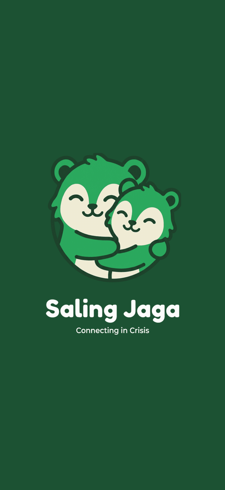 | 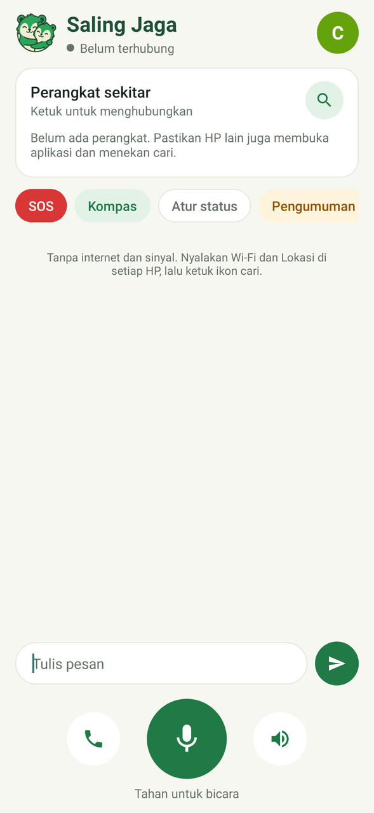 | 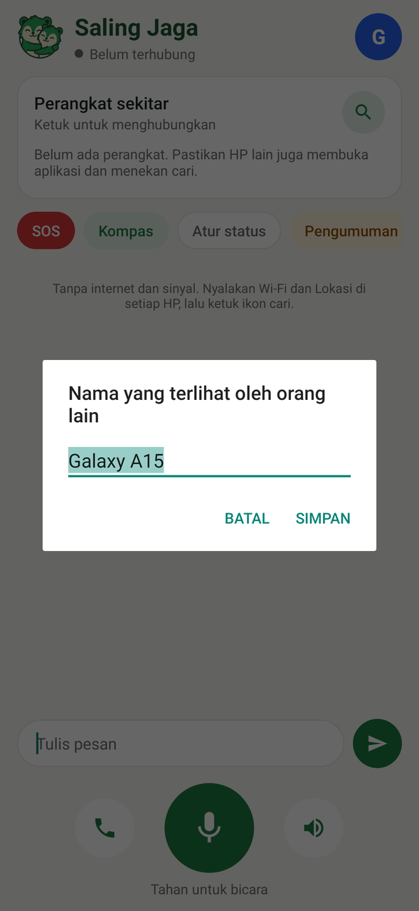 |

| Cari perangkat | Grup & chat | Mode telepon |
| --- | --- | --- |
| 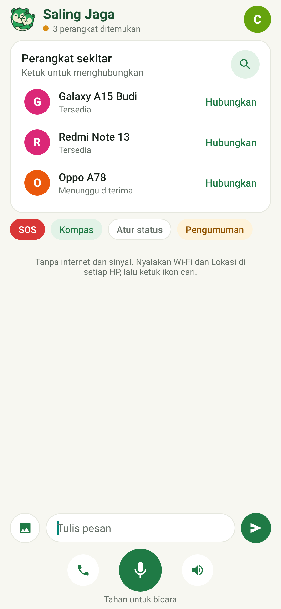 | 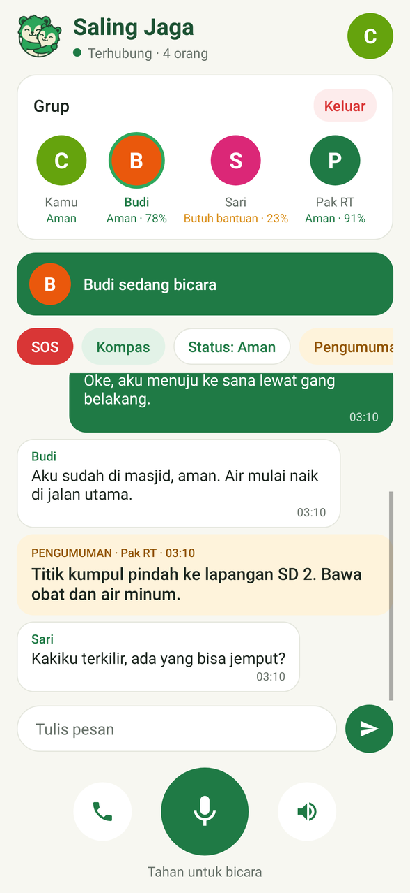 | 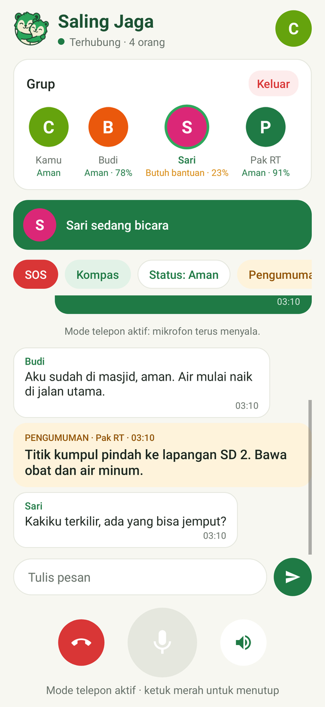 |

| Pilih status | Tulis pengumuman | Kirim SOS / SOS + SMS |
| --- | --- | --- |
| 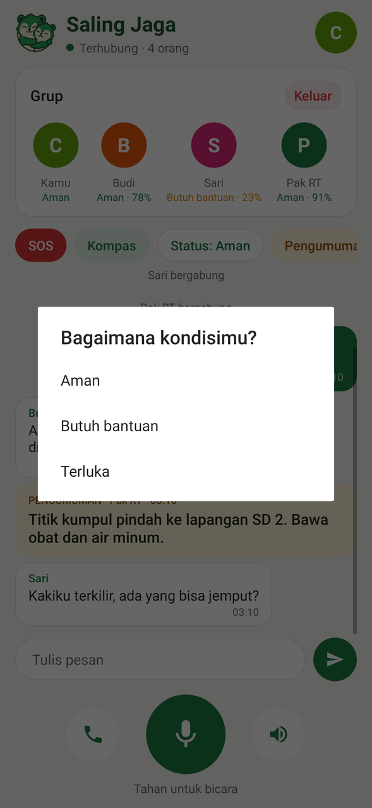 | 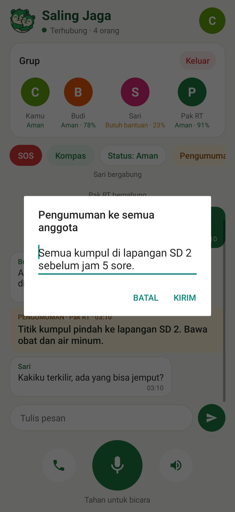 | 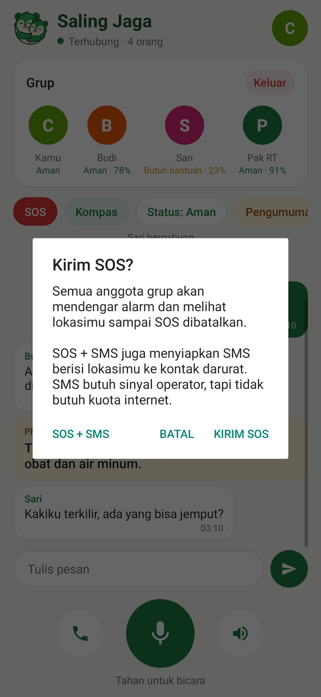 |

| SOS masuk | SOS sendiri & anggota terputus | Kompas |
| --- | --- | --- |
| 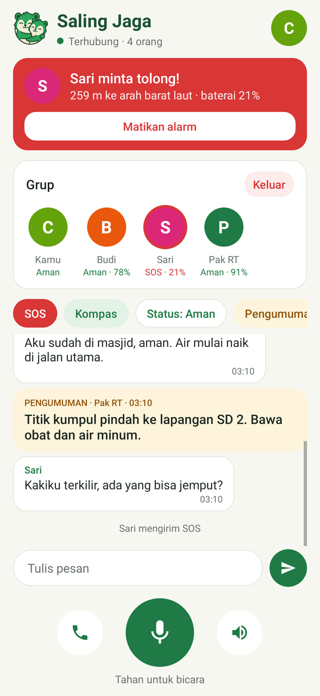 | 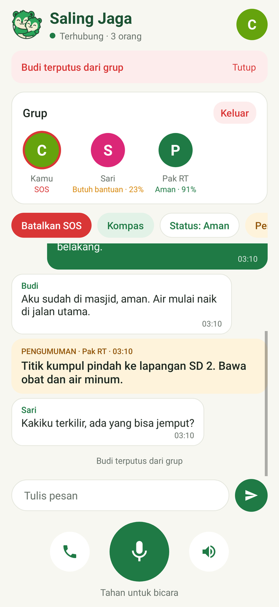 | 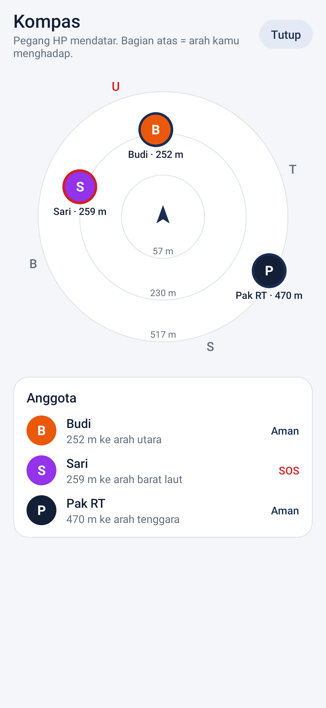 |

| Menu profil | Kontak darurat SMS |   |
| --- | --- | --- |
| 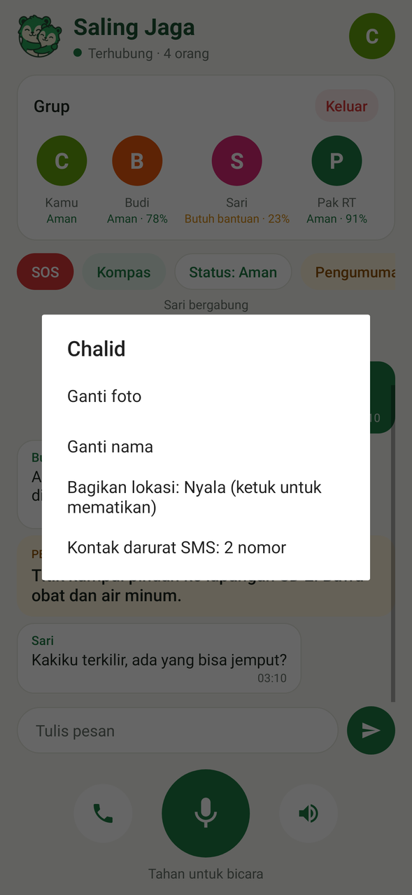 | 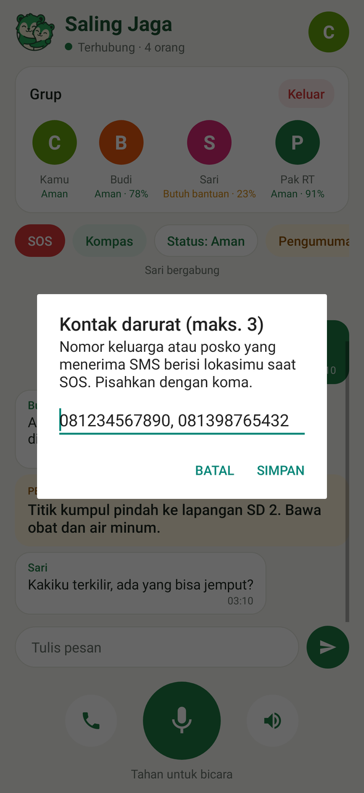 |   |

Screenshot dirender otomatis dari kode, bukan mockup (lihat [Pengujian](#pengujian)). Nama dan pesan di dalamnya hanya contoh.

## Fitur

**Komunikasi**
- **Tahan untuk bicara**: walkie-talkie ke seluruh anggota grup.
- **Mode telepon**: suara dua arah terus-menerus, dengan peredam gema dan derau bawaan HP.
- **Chat teks** dan **Pengumuman**. Pengumuman berupa kartu kuning yang berbunyi di semua HP, cocok untuk info titik kumpul dari posko atau ketua rombongan.
- **Grup lebih dari 2 HP**. Satu HP menjadi pemilik grup dan meneruskan suara serta pesan ke semua anggota.

**Keselamatan**
- **SOS**: semua HP membunyikan alarm keras dan bergetar. Muncul juga kartu merah berisi jarak dan arah ke pengirim, misalnya "259 m ke arah barat laut". SOS tetap aktif sampai pengirim membatalkannya, dan anggota yang baru bergabung tetap melihatnya.
- **SOS + SMS**: cadangan saat BTS masih hidup tapi tidak ada kuota internet. Aplikasi menyiapkan SMS berisi link lokasi Google Maps dan baterai ke maksimal 3 kontak darurat (atur di menu profil), lalu Anda tinggal menekan kirim. Tidak butuh izin SMS.
- **Status diri**: Aman / Butuh bantuan / Terluka. Status ini tampil di bawah foto tiap anggota bersama **level baterai**.
- **Kompas**: radar yang menunjukkan posisi tiap anggota sesuai arah aslinya dan ikut berputar saat HP diputar. GPS bekerja tanpa internet.
- **Peringatan anggota terputus**: kalau ada HP yang keluar jangkauan atau mati, semua anggota tahu dalam sekitar 10 detik lewat getar, bunyi, dan banner.

**Kenyamanan**
- Tetap tersambung saat layar mati. SOS, pesan, dan peringatan muncul sebagai notifikasi di layar kunci.
- Foto profil dan nama tampil di daftar anggota dan saat seseorang bicara.
- Tombol **Bagikan lokasi** di menu profil, default nyala. Saat dimatikan, GPS ikut berhenti supaya hemat baterai.
- Ukuran APK sekitar 200 KB dan berjalan di Android 6.0 ke atas.

## Cara instal di HP

Saling Jaga belum ada di Play Store, jadi dipasang langsung dari file APK (sekitar 200 KB, Android 6.0 ke atas). Pasang sebelum bencana atau sebelum berangkat, selagi masih ada internet.

1. Buka link ini di HP Android: **[saling-jaga.apk](https://github.com/chalidade/saling-jaga/releases/latest/download/saling-jaga.apk)**. Semua versi ada di halaman [Releases](https://github.com/chalidade/saling-jaga/releases).
2. Kalau browser memperingatkan file berbahaya, pilih **Tetap unduh**. Peringatan ini muncul untuk semua APK dari luar Play Store.
3. Buka `saling-jaga.apk` dari notifikasi unduhan atau aplikasi File.
4. Jika muncul "Instal aplikasi tidak dikenal", ketuk **Setelan**, aktifkan **Izinkan dari sumber ini**, lalu kembali.
5. Ketuk **Instal**. Jika Play Protect bertanya, pilih **Instal saja** / **Instal tanpa memindai**.

Untuk anggota rombongan yang tidak punya internet, kirim file APK dari HP yang sudah memasangnya lewat Quick Share / Nearby Share, Bluetooth, atau kabel data.

> Selama aplikasi belum memakai kunci rilis permanen, APK versi baru mungkin menolak dipasang di atas versi lama ("Aplikasi tidak terpasang"). Hapus dulu versi lama, lalu pasang lagi.

## Apakah aman dipasang di luar Play Store?

Android memperingatkan setiap APK yang tidak berasal dari Play Store, termasuk aplikasi yang aman. Cara memastikan APK Saling Jaga bisa dipercaya:

- **Kodenya terbuka.** Semua kode ada di repositori ini dan bisa diperiksa siapa pun. Aplikasinya kecil (sekitar 200 KB) dan tidak memakai library pihak ketiga, jadi tidak ada kode tersembunyi dari SDK iklan atau analitik.
- **APK dibangun oleh GitHub, bukan di laptop pribadi.** File di halaman [Releases](https://github.com/chalidade/saling-jaga/releases) dibuat otomatis oleh GitHub Actions dari kode publik. Setiap rilis mencantumkan commit asal dan link ke log build-nya.
- **Cek keaslian file.** Setiap rilis mencantumkan SHA-256 APK dan sidik jari sertifikat penandatangan. File yang diunduh dari sumber lain (grup WhatsApp, Bluetooth) bisa dicocokkan dengan angka ini. File juga bisa dipindai gratis di [VirusTotal](https://www.virustotal.com).
- **Tidak mengirim data ke internet.** Tidak ada server, akun, iklan, atau pelacak. Data hanya dikirim langsung ke HP anggota grup lewat Wi‑Fi Direct.
- **Izin seperlunya:**

  | Izin | Untuk apa |
  | --- | --- |
  | Lokasi / Perangkat sekitar | Wajib dari Android untuk mencari HP lewat Wi‑Fi Direct, dan untuk kompas serta jarak SOS |
  | Mikrofon | Walkie-talkie dan mode telepon, hanya saat tombol ditahan atau telepon aktif |
  | Notifikasi | SOS dan pesan saat layar mati |
  | Internet / jaringan | Membuka koneksi TCP ke HP lain di grup. Tidak dipakai untuk menghubungi server mana pun |
  | Getar, wake lock, layanan latar | Alarm SOS dan tetap tersambung saat layar mati |

  Saling Jaga **tidak** meminta akses kontak, SMS, file/galeri penuh, kamera, atau log panggilan. Foto profil dipilih lewat pemilih foto bawaan Android, dan SOS + SMS memakai aplikasi SMS Anda sendiri.

## Cara pakai

1. Nyalakan **Wi‑Fi** dan **Lokasi** di setiap HP. Wi‑Fi tidak perlu tersambung ke jaringan mana pun dan tidak perlu menyalakan hotspot. Data seluler boleh mati.
2. Buka aplikasi, isi nama, lalu beri izin Lokasi/Perangkat sekitar, Mikrofon, dan Notifikasi.
3. Ketuk ikon **cari** di semua HP. Ketuk nama HP teman, lalu HP teman menekan **Terima** pada undangan.
4. Setelah status hijau **Terhubung**, tahan tombol mikrofon untuk bicara, atau ketuk ikon telepon untuk mode panggilan.
5. Gunakan chip di atas chat:
   - **SOS**: alarm di semua HP, sampai Anda membatalkannya.
   - **Kompas**: arah dan jarak ke tiap anggota.
   - **Status**: Aman / Butuh bantuan / Terluka.
   - **Pengumuman**: kartu kuning untuk info penting, misalnya titik kumpul.
6. Ketuk foto profil di kanan atas untuk mengganti foto/nama atau mematikan **Bagikan lokasi**. Ketuk **Keluar** di kartu Grup untuk meninggalkan grup.

Jangkauan Wi‑Fi Direct biasanya 50–100 m di area terbuka dan lebih pendek di dalam gedung. Kunci GPS pertama tanpa internet bisa butuh 1–3 menit di tempat terbuka.

## Cara kerja

```
 HP anggota ──┐
 HP anggota ──┼── Wi‑Fi Direct (WPA2) ── HP pemilik grup ── meneruskan ke semua
 HP anggota ──┘                           (server TCP di 192.168.49.1:8988)
```

- **Penemuan dan koneksi**: memakai `WifiP2pManager` bawaan Android, tanpa library pihak ketiga.
- **Protokol**: frame biner sederhana di atas TCP, berisi `tipe · pengirim · panjang · isi`. Tipenya `HELLO` (nama + foto), `TEXT`, `AUDIO` (PCM 16 kHz mono, potongan 20 ms), `TALK_START/END`, `PRESENCE` (status, baterai, lokasi), `ANNOUNCE`, `LEAVE`, `PING`, dan `REJECT`.
- **Relay**: pemilik grup meneruskan setiap frame ke anggota lain. Ia juga mengirim ulang daftar anggota dan status terakhir, termasuk SOS yang masih aktif, ke HP yang baru bergabung.
- **Deteksi putus**: setiap koneksi mengirim `PING` tiap 3 detik. Koneksi yang diam lebih dari 10 detik dianggap putus.
- **Latar belakang**: foreground service menahan CPU dan Wi‑Fi tetap aktif selama berada di grup.

## Keamanan

Yang sudah diterapkan:
- Server hanya mendengarkan di alamat grup Wi‑Fi Direct, sehingga perangkat di Wi‑Fi kafe atau hotspot yang sama tidak bisa masuk.
- Lalu lintas di udara terenkripsi WPA2 milik Wi‑Fi Direct, dan anggota harus disetujui lewat undangan.
- Pemilik grup menolak frame yang mengaku dari anggota lain, sehingga tidak ada SOS atau pengumuman palsu atas nama orang lain. Nama ganda dalam satu grup juga ditolak.
- Ukuran setiap jenis pesan dan dimensi foto dibatasi, sehingga satu HP tidak bisa membuat HP lain crash.

Belum ada (direncanakan):
- **Identitas terverifikasi**: kunci digital per HP, kode pendek `SJ-XXXX-XXXX` + QR untuk pendataan, dan label "Posko terverifikasi" untuk pengumuman resmi.
- **Enkripsi ujung ke ujung** dengan kunci grup.
- Kunci rilis permanen. Selama secret kunci rilis belum diisi, APK ditandatangani dengan kunci sementara yang bisa berbeda di tiap rilis.

## Batasan saat ini

- Jika aplikasi ditutup paksa (diusap dari daftar aplikasi terbaru), koneksi grup ikut berhenti.
- Suara dikirim mentah sekitar 256 kbps. Cukup untuk Wi‑Fi Direct, tapi belum hemat baterai.
- Kebanyakan HP hanya bisa ikut satu grup Wi‑Fi Direct dalam satu waktu, sehingga belum ada multihop.
- Riwayat chat belum disimpan, dan belum ada sambung ulang otomatis.

## Peta jalan

1. Uji lapangan di 2–5 HP dari berbagai merek.
2. Identitas terverifikasi dan enkripsi.
3. Multihop untuk pesan, SOS, lokasi, dan voice note.
4. Integrasi LoRa (perangkat Meshtastic lewat Bluetooth) untuk jangkauan 2–10 km.
5. Peta offline, absen/hitung kepala, senter strobo SOS, kartu medis, mode hemat baterai, dan panduan P3K.
6. Dasbor posko berbasis web di laptop yang membaca alat LoRa lewat USB/Bluetooth.
7. Rilis di Google Play dengan verifikasi developer Android.

## Build

Aplikasi ini sengaja dibangun **tanpa Gradle/AGP dan tanpa dependensi**, cukup dengan paket Android SDK dari Ubuntu/Debian:

```bash
sudo apt-get install android-sdk-platform-23 aapt dalvik-exchange apksigner zipalign
./build.sh            # hasil: build/saling-jaga-debug.apk
```

Kodenya ditulis dalam Java 8 dengan UI yang dibangun langsung di kode (tanpa XML layout dan tanpa AndroidX). APK dikompilasi terhadap API 23 dengan `targetSdkVersion` 33. API Android 8+ seperti notification channel dipanggil lewat reflection.

## Pengujian

```bash
./build.sh
cd tools/screenshot-tests && gradle test
```

- `EmergencySmsTest` menguji pembersihan nomor kontak darurat dan isi SMS SOS.
- `HubTest` menjalankan tiga hub di atas socket sungguhan. Yang diuji: relay pesan, teks, dan suara; pengiriman ulang SOS ke anggota baru; penolakan penyamaran; batas ukuran pesan; penolakan nama ganda; dan deteksi anggota keluar.
- `ScreenshotTest` merender layar aplikasi dengan Robolectric (native graphics) ke `tools/screenshot-tests/out/`. Gambar di README berasal dari tes ini.

GitHub Actions:
- `build.yml` menjalankan build dan kedua tes di setiap push dan PR, lalu mengunggah APK dan screenshot sebagai artefak.
- `release.yml` membangun APK di setiap push ke `main` dan menaruhnya di GitHub Release `v<versionName>` sebagai `saling-jaga.apk`. Jika secret `SIGNING_KEYSTORE_B64` (keystore dalam base64), `SIGNING_KS_PASS`, `SIGNING_KEY_ALIAS`, dan `SIGNING_KEY_PASS` diisi, APK ditandatangani dengan kunci rilis.
- `pages.yml` menerbitkan folder `docs/` ke GitHub Pages (situs web proyek).

## Struktur proyek

```
app/src/main/
  AndroidManifest.xml
  java/com/salingjaga/app/
    MainActivity.java      UI, Wi‑Fi Direct, mode bencana, kompas
    Hub.java               grup: server/klien, relay, anggota, anti-penyamaran
    Link.java              satu koneksi TCP: thread baca/tulis, ping, batas ukuran
    Frame.java             tipe pesan dan batas ukurannya
    Presence.java          status, baterai, lokasi
    Voice.java             rekam & putar suara (AudioRecord/AudioTrack)
    RadarView.java         radar kompas
    Avatars.java           foto profil bulat / inisial
    Alerts.java            notifikasi sistem
    EmergencySms.java      SOS lewat SMS: nomor kontak dan isi pesan
    KeepAliveService.java  tetap tersambung saat layar mati
  res/                     ikon, logo, splash, ikon vektor
build.sh                   build APK tanpa Gradle
tools/screenshot-tests/    tes protokol + render screenshot
docs/                      situs web (index.html), logo, splash, screenshot
```

## Model keberlanjutan

- **Warga**: gratis selamanya.
- **Edisi Tim / Posko** (berbayar): dasbor koordinator, peta offline, absen massal, laporan pasca-kejadian, banyak grup, dan kanal terenkripsi.
- **Institusi**: BPBD, Basarnas, PMI, sekolah, dan perusahaan tambang/migas, berupa lisensi, kustomisasi, dan pelatihan.
- **Perangkat keras**: paket node LoRa untuk posko dan desa rawan bencana.

## Lisensi

Saling Jaga memakai model **open-core**:

- **Aplikasi warga** (repositori ini) berlisensi [GNU AGPL-3.0-or-later](LICENSE). Siapa pun boleh memakai,
  mempelajari, mengubah, dan membagikannya. Siapa pun yang membagikan atau menjalankan versi modifikasi
  wajib membuka kode sumbernya dengan lisensi yang sama.
- **Edisi Posko / Tim** (dasbor koordinator, peta offline, absen massal, laporan, enkripsi tim)
  dikembangkan terpisah dengan lisensi komersial.
- **Nama, logo, dan slogan "Saling Jaga"** adalah merek dan tidak termasuk dalam AGPL. Lihat
  [TRADEMARK.md](TRADEMARK.md).

Copyright (C) 2026 Chalid Ade Rahman
