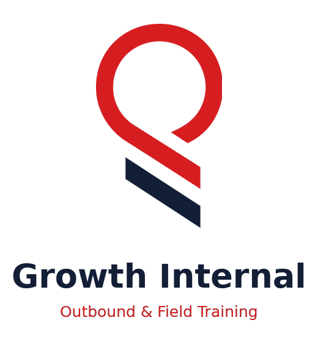
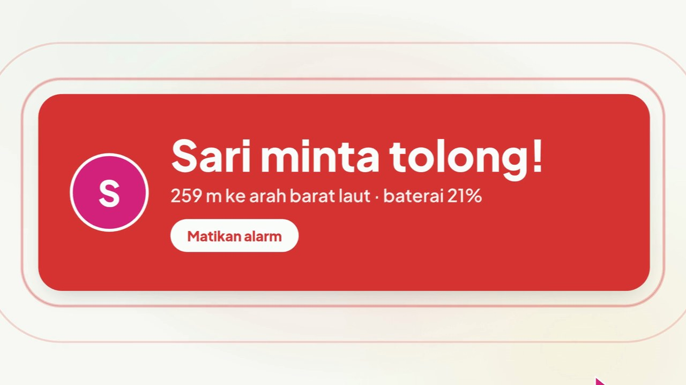
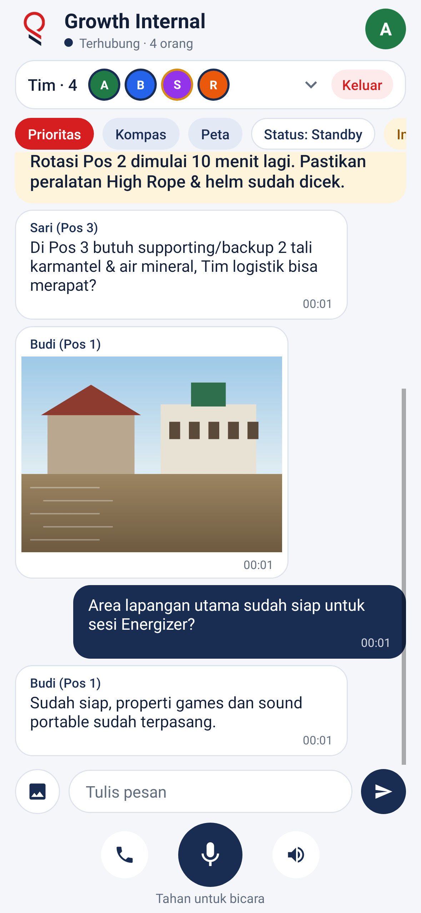
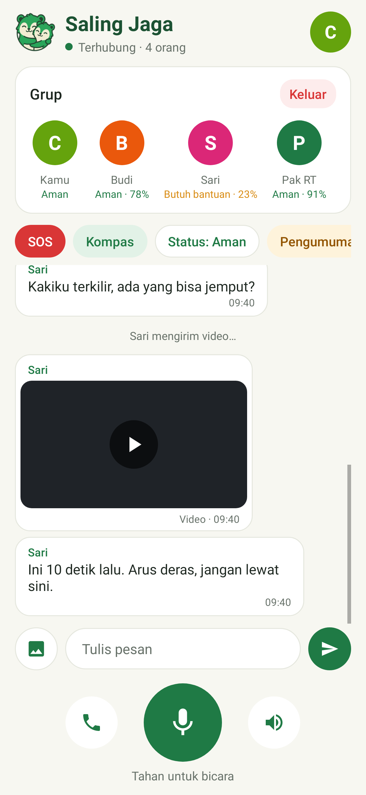
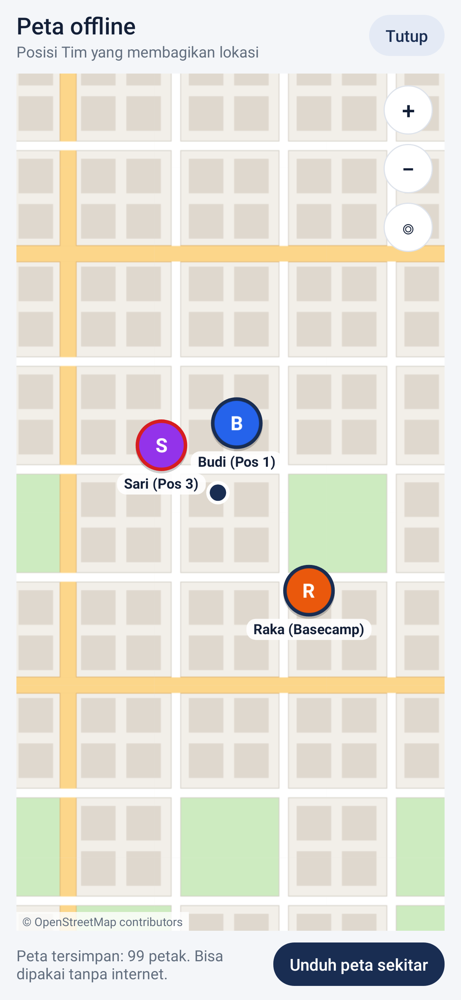
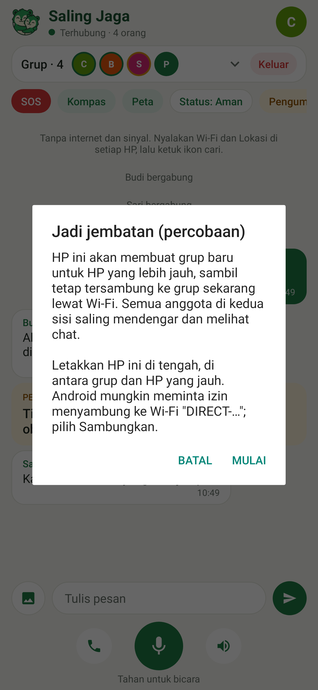

<p align="center">
  
</p>

<p align="center"><b>Outbound & Field Training Communication</b>: telepon, walkie-talkie, chat, lokasi, dan koordinasi prioritas antar HP Android Tim Growth Indonesia tanpa internet dan tanpa sinyal.</p>

<p align="center">
  <a href="https://github.com/nafta121/growth-internal/releases/latest/download/growth-internal.apk"><b>⬇️ Unduh APK</b></a>
  &nbsp;·&nbsp;
  <a href="#cara-instal-di-hp">Cara instal</a>
  &nbsp;·&nbsp;
  <a href="https://nafta121.github.io/growth-internal/">Situs web</a>
</p>

<p align="center">
  
</p>

---

Saat kegiatan **Outbound, Experiential Learning, dan Corporate Training** berlangsung di area perkemahan, pegunungan, resort, atau *venue* luar ruang, sinyal seluler dan kuota internet sering kali tidak stabil atau hilang. **Growth Internal** menghubungkan HP Tim secara langsung lewat radio Wi‑Fi di dalam HP (Wi‑Fi Direct). Tidak butuh kartu SIM, router, server, atau Google Play Services. Seluruh Tim Fasilitator, PIC, Basecamp, dan Logistik tetap bisa berkomunikasi, memantau kesiapan pos, mengoordinasikan rotasi, serta mengirim panggilan prioritas.

> **Status:** v0.20.0. Seluruh fitur komunikasi lapangan multi-transport (*Wi‑Fi Aware, Hotspot/LAN, Wi‑Fi Direct, Bluetooth L2CAP/RFCOMM, BLE Mesh, dan BlueRange MeshAccess Zero-Action Relay*), auto-update internal dari GitHub Releases, peta offline, kompas, dan protokol *mesh* telah teruji otomatis.

## Tampilan

| Pembuka | Layar awal | Isi nama pertama kali |
| --- | --- | --- |
|  |  |  |

| Cari perangkat | Tim & chat | Mode telepon |
| --- | --- | --- |
|  |  |  |

| Pilih status | Tulis instruksi | Kirim Prioritas / Prioritas + SMS |
| --- | --- | --- |
|  |  |  |

| Panggilan Prioritas masuk | Prioritas aktif & Tim terputus | Kompas Tim |
| --- | --- | --- |
|  |  |  |

| Menu profil | Kontak PIC / Basecamp SMS | Kirim foto pos |
| --- | --- | --- |
|  |  |  |

| Kirim video lapangan | Peta offline | Jadi jembatan (multihop) |
| --- | --- | --- |
|  |  |  |

Screenshot dirender otomatis dari kode (lihat [Pengujian](#pengujian)). Nama dan pesan di dalamnya adalah simulasi operasional Outbound & Training Tim Growth Indonesia.

## Fitur

**Komunikasi Tim Lapangan**
- **Tahan untuk bicara**: *walkie-talkie* (HT digital) ke seluruh anggota Tim.
- **Mode telepon**: suara dua arah terus-menerus untuk koordinasi intensif antara Fasilitator dan PIC, dilengkapi peredam gema dan derau bawaan HP.
- **Chat teks** dan **Instruksi**. Instruksi berupa kartu kuning yang berbunyi di semua HP, cocok untuk pengumuman *rotasi pos*, *ice breaking*, *debriefing*, atau perubahan *rundown* dari PIC / Basecamp.
- **Kirim foto** dari kamera atau galeri. Foto dikecilkan otomatis (maks. 1280 px, di bawah 400 KB) supaya cepat terkirim untuk melaporkan kesiapan properti *games* atau kondisi pos.
- **Kirim klip video** maksimal 15 detik dengan kualitas hemat (maks. 4 MB). Klip dikirim dalam potongan 32 KB saat kanal suara senggang sehingga *push-to-talk* dan telepon tetap lancar.
- **Tim lebih dari 2 HP**. Satu HP menjadi pemilik grup dan meneruskan suara serta pesan ke seluruh Tim yang terhubung.

**Koordinasi & Prioritas Lapangan**
- **Prioritas**: semua HP Tim membunyikan dering perhatian dan bergetar. Muncul kartu merah berisi jarak dan arah ke pengirim (misalnya `"259 m ke arah barat laut"`) untuk kebutuhan *supporting/backup* mendesak di pos atau *High Rope*. Tetap aktif sampai pengirim mengakhirinya.
- **Prioritas + SMS**: cadangan saat pos berada di luar jangkauan Wi‑Fi Direct tetapi masih ada sinyal seluler tanpa kuota internet. Aplikasi menyiapkan SMS berisi link koordinat Google Maps dan sisa baterai ke maksimal 3 nomor PIC / Basecamp.
- **Status tugas lapangan**: `Standby` / `Butuh Backup` / `Kendala`. Status ini tampil di bawah foto tiap anggota Tim bersama **level baterai**.
- **Peta offline**: unduh peta jalan OpenStreetMap radius ±3 km di sekitar *venue* selagi masih ada internet. Setelah tersimpan, peta bisa dibuka tanpa internet dan menampilkan posisi setiap anggota Tim sesuai warna statusnya.
- **Kompas**: radar yang menunjukkan posisi tiap anggota Tim sesuai arah aslinya dan ikut berputar saat HP diputar. GPS bekerja tanpa internet.
- **Jembatan / Relay (percobaan)**: anggota Tim bisa memilih **Jadi jembatan** di menu profil untuk menghubungkan pos yang berjauhan (misal: antara *Basecamp*, *Main Hall*, dan *Area High Rope*).
- **Peringatan Tim terputus**: jika ada HP anggota Tim yang keluar jangkauan atau kehabisan baterai, seluruh Tim mengetahui dalam sekitar 10 detik lewat getar, bunyi, dan banner.

**Kenyamanan Operasional**
- Tetap tersambung saat layar mati di saku selama memfasilitasi sesi. Panggilan prioritas, instruksi, dan pesan muncul di layar kunci.
- Foto profil dan nama/pos tampil di daftar Tim dan saat seseorang berbicara.
- Tombol **Bagikan lokasi** di menu profil (default nyala). Saat dimatikan, GPS ikut berhenti untuk menghemat baterai.
- Ukuran APK sekitar 175 KB dan berjalan di Android 6.0 ke atas.

## Cara instal di HP

1. Buka link ini di HP Android: **[growth-internal.apk](https://github.com/nafta121/growth-internal/releases/latest/download/growth-internal.apk)**. Semua versi ada di halaman [Releases](https://github.com/nafta121/growth-internal/releases).
2. Jika browser menampilkan peringatan unduhan APK, pilih **Tetap unduh**.
3. Buka `growth-internal.apk` dari notifikasi unduhan atau aplikasi File.
4. Jika muncul "Instal aplikasi tidak dikenal", ketuk **Setelan**, aktifkan **Izinkan dari sumber ini**, lalu kembali.
5. Ketuk **Instal**.

Untuk rekan Tim di *venue* yang tidak memiliki akses internet, kirim file APK dari HP yang sudah memasangnya lewat Quick Share / Nearby Share atau Bluetooth.

## Cara pakai di Lapangan

1. Nyalakan **Wi‑Fi** dan **Lokasi** di setiap HP Tim. Wi‑Fi tidak perlu tersambung ke jaringan mana pun dan tidak perlu menyalakan hotspot.
2. Buka aplikasi, isi nama beserta keterangan pos/peran (contoh: `Andi (PIC)`, `Budi (Pos 1)`, `Sari (Pos 3)`), lalu berikan izin Lokasi/Perangkat sekitar, Mikrofon, dan Notifikasi.
3. Ketuk ikon **cari** di semua HP. Ketuk nama HP rekan Tim, lalu tekan **Terima** pada undangan.
4. Setelah status **Terhubung**, tahan tombol mikrofon untuk bicara (*walkie-talkie*), atau ketuk ikon telepon untuk mode panggilan terbuka.
5. Gunakan *chip* di atas layar chat:
   - **Prioritas**: memanggil *supporting/backup* segera ke titik Anda.
   - **Kompas**: arah dan jarak ke tiap rekan Tim.
   - **Peta**: peta lokasi *venue* secara luring (*offline*).
   - **Status**: `Standby` / `Butuh Backup` / `Kendala`.
   - **Instruksi**: kartu pengumuman penting dari PIC / Basecamp ke seluruh Tim.

## Build & Pengujian

```bash
sudo apt-get install android-sdk-platform-23 aapt dalvik-exchange apksigner zipalign
./build.sh            # hasil: build/growth-internal-debug.apk
cd tools/screenshot-tests && gradle test
```

## Struktur proyek

```
app/src/main/
  AndroidManifest.xml
  java/com/growthinternal/app/
    MainActivity.java      UI, Wi‑Fi Direct, koordinasi lapangan, kompas, peta
    MeshCoordinator.java   koordinasi auto-connect multi-transport, anti-loop ClusterId, relay pasif
    MeshAccess.java        BlueRange MeshAccessModule (0xFE12), 4-Way Handshake AES-128, split/reassemble
    Aware.java             Wi‑Fi Aware (NAN) discovery & high-speed IPv6 data-path tanpa popup
    Lan.java               Hotspot / Wi‑Fi Lokal UDP broadcast discovery (port 8988)
    Bt.java                Bluetooth BLE L2CAP CoC, MeshAccess GATT tunnel, dan Insecure RFCOMM
    Ble.java               BLE 20-byte beacon, BLE Flood Mesh (TTL 5), AdvertisingWatchdog
    Adpcm.java             kompresi suara IMA ADPCM 4:1 (32 kbps) untuk jalur Bluetooth/BLE
    ApkShare.java          server HTTP lokal pembagi APK offline tanpa internet
    Updater.java           auto-update internal dari GitHub Releases dengan verifikasi SHA-256
    Hub.java               grup: server/klien, multi-hop relay, ClusterId, Store-and-Forward, anti-penyamaran
    Link.java              satu koneksi TCP: thread baca/tulis, ping, batas ukuran
    Frame.java             tipe pesan dan batas ukurannya
    Presence.java          status tugas (Standby, Butuh Backup, Kendala, PRIORITAS), baterai, lokasi
    Voice.java             rekam & putar suara (AudioRecord/AudioTrack)
    RadarView.java         radar kompas Tim
    Avatars.java           foto profil bulat / inisial
    Photos.java            kompres & decode foto yang dikirim di grup
    Tiles.java             peta offline: hitung, unduh, dan simpan petak OpenStreetMap
    MapView.java           peta yang bisa digeser/zoom dengan titik anggota Tim
    Bridge.java            multihop: sambungan Wi‑Fi ke grup lain lewat IPv6 link-local
    Clips.java             potong & susun ulang klip video yang dikirim di grup
    CaptureProvider.java   file tujuan foto/video kamera (tanpa izin kamera)
    Alerts.java            notifikasi sistem
    EmergencySms.java      Prioritas lewat SMS ke nomor PIC / Basecamp
    KeepAliveService.java  tetap tersambung saat layar mati
  res/                     ikon, logo, splash, ikon vektor
build.sh                   build APK tanpa Gradle
tools/screenshot-tests/    tes protokol + render screenshot otomatis
docs/                      situs web (index.html), logo, splash, screenshot
```

## Lisensi

Proyek ini berlisensi di bawah [GNU AGPL-3.0-or-later](LICENSE). Nama dan logo **"Growth Internal"** diatur dalam [TRADEMARK.md](TRADEMARK.md).
